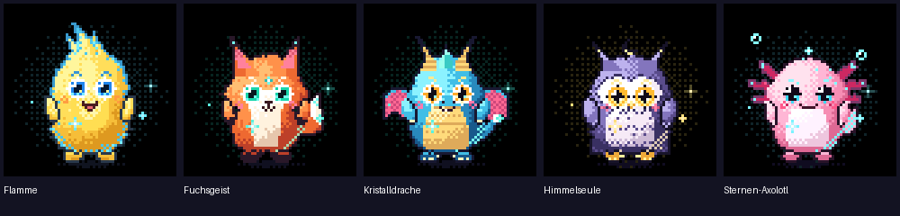

# SI-M · Super Intelligence Mobile

**Android-Begleit-App für den SI-M Orb.** Einrichtung, Gerätesteuerung und eigene animierte Figuren in einer App. Dieses Repository liefert Quellcode, **keinen fertigen APK-Download**; die kompatible Orb-Firmware ist ein separates Projekt.



*Vorschau aus den mitgelieferten RGB565-Frames; kein Gerätescreenshot.*

## Funktionen

- **Lokales Profil:** Anmeldung ohne Server mit PBKDF2-HMAC-SHA256 und Android-Keystore-verschlüsselten Preferences.
- **Bluetooth LE:** Scan, Kopplung mit System-Passkey und gegenseitiger Besitznachweis. Schreibende Gerätebefehle erfordern ein physisch geöffnetes Setup-Fenster am Orb.
- **Orb-Steuerung:** WLAN suchen, speichern und entfernen mit Rücklesung; Lautstärke, Helligkeit und Ruhemodus.
- **Figuren:** Gerätekatalog und Auswahl, fünf mitgelieferte C-gerenderte Figuren (Flamme, Fuchsgeist, Kristalldrache, Himmelseule, Sternen-Axolotl). Der portable C11-Renderer unter [`shared/`](shared/) ermöglicht reproduzierbare, zufällig erzeugte Figuren und native Android-Vorschauen. Die RGB565-Dateien sind Referenzframes, keine Fotos oder Gerätescreenshots.
- **Sprachdienst-Konfiguration:** HTTPS-Bridge für `/v1/turn-stream` einschließlich Bearer-Zugangsdaten auf dem Orb hinterlegen oder entfernen. Stimme, Persona und Erinnerungen sind getrennte Zuständigkeiten; ein öffentlicher KI-Dienst und Zugangsdaten sind nicht enthalten.
- **Kamera:** lokale CameraX-Vorschau; keine Bildübertragung zum Orb und keine behauptete Objekterkennung.

Backups sind deaktiviert. Der App-Quellcode ersetzt keine Sicherheits- oder Funktionsprüfung auf echter Hardware.

## Selbst bauen

Android Studio mit **JDK 17**, **Android SDK 35**, **Build-Tools 36.0.0**, **NDK 27.0.12077973** und **CMake 3.22.1** verwenden. Den Projektroot öffnen; `local.properties` mit dem SDK-Pfad nur lokal erzeugen. Das Android-CMake-Projekt bindet `shared/` relativ zum Projektroot ein.

```sh
./gradlew :app:assembleDebug
./gradlew :app:testDebugUnitTest
```

Unter Windows `gradlew.bat` verwenden. Die Debug-APK entsteht unter `app/build/outputs/apk/debug/app-debug.apk`. Sie trägt einen **Debug-Signaturschlüssel**, nicht automatisch das Zertifikat einer zuvor installierten App. Für ein Update ist deren bestehendes Release-Zertifikat nötig; Signing-Keys und eine veröffentlichte Release-APK sind hier nicht enthalten. Quellversion: **1.2.1 (versionCode 7)**.

Renderer-Testanleitung: [`shared/README.md`](shared/README.md). Ein kompletter Sprachdialog erfordert separat bereitgestellte kompatible Orb-Firmware und einen eigens konfigurierten Dienst; der App-Build allein beweist keinen Gerätebetrieb.

## Herkunft und Rechte

Laut Ersteller hat er die fünf Figuren mit Muse-Code und Gemini entworfen; die RGB565-Frames stammen aus diesen eigenen Firmware-Renderern. Die Browser-Erstellerdatei baut auf einer prozeduralen Muse-Vorlage auf. Muse-SDK-Code steht unter **Apache-2.0**; die ursprüngliche **Jollybot-Figur ist ausdrücklich ausgenommen**. Siehe [`THIRD_PARTY_NOTICES.md`](THIRD_PARTY_NOTICES.md) und den [vollständigen Upstream-Lizenztext](THIRD_PARTY_MUSE_APACHE_2.0.txt). Diese Hinweise vergeben **keine pauschale Lizenz für eigenständige SI-M-Beiträge**; für diese wurde keine Projektlizenz festgelegt.

## Stand und Grenzen

Keine Release-APK, keine behauptete CI-Freigabe und **kein implementierter GitHub-In-App-Updater**. Probleme können über GitHub-Issues gemeldet werden; bitte dort keine Zugangsdaten, privaten Endpunkte oder personenbezogenen Logs veröffentlichen.
